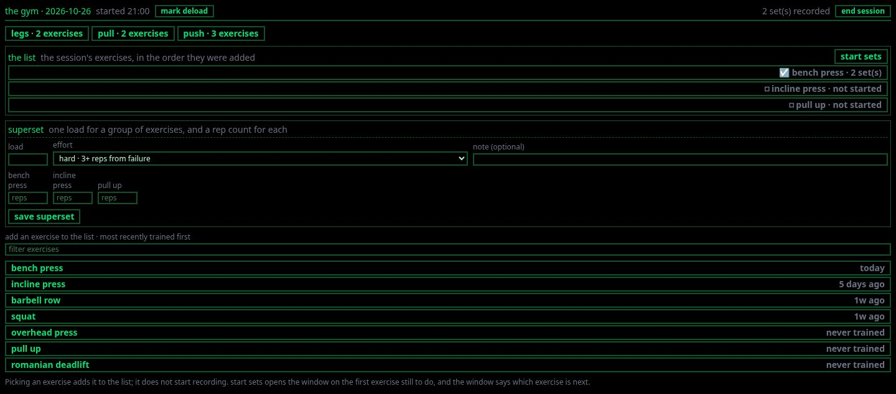
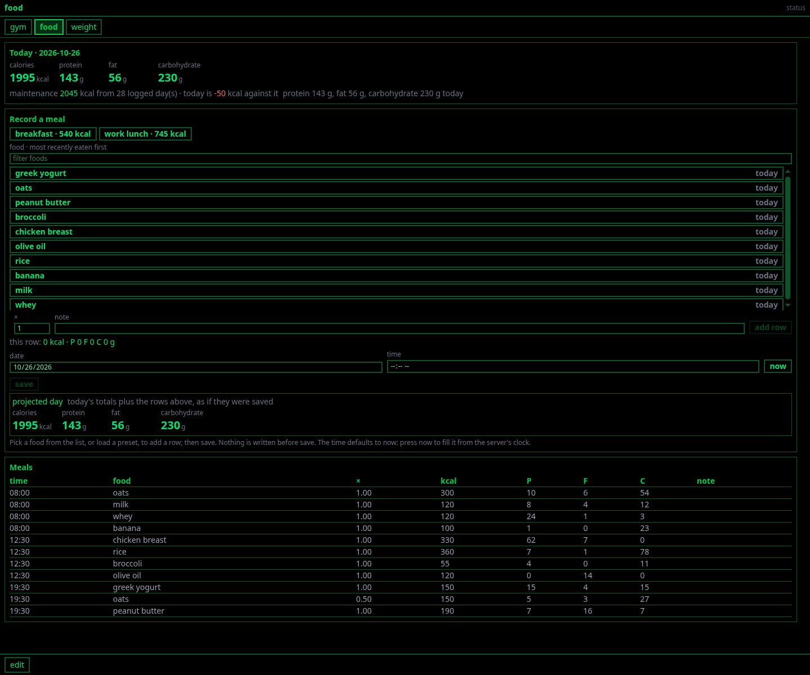
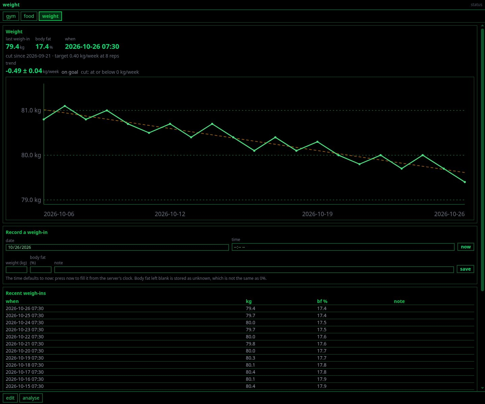
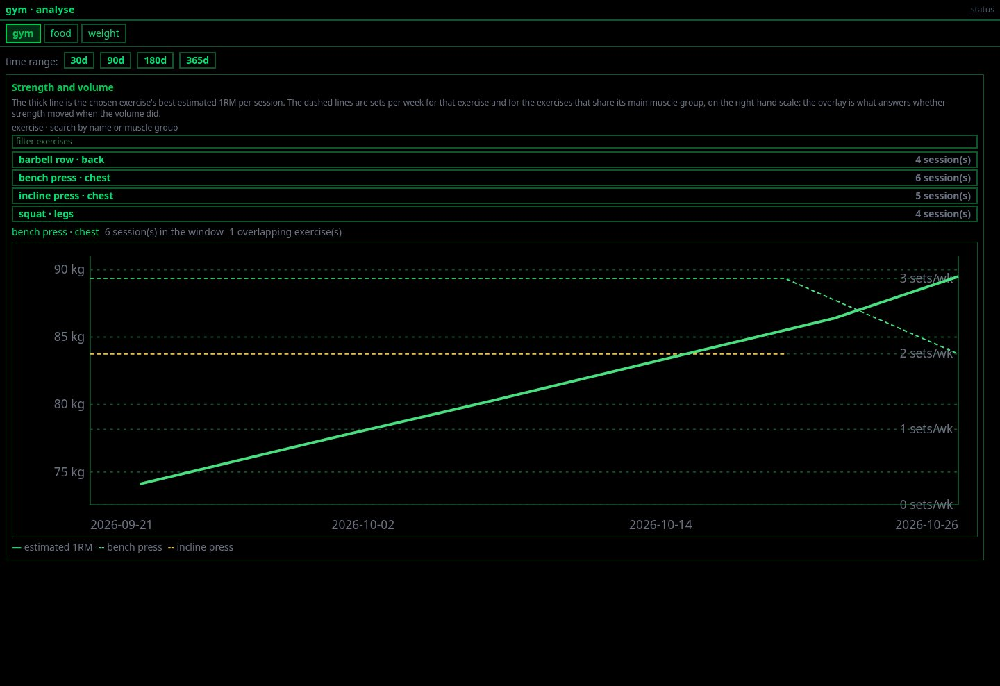

# gym

A local-first fitness tracker for progressive overload, body weight and food.
It records your training sets, weigh-ins and meals in one [SQLite][sqlite] file
on your machine, with no server and no account. `gym web` reads the same file
in a browser, on loopback.






[sqlite]: https://sqlite.org

## Install

Builds and installs the `gym` binary into `$CARGO_HOME/bin` (default
`~/.cargo/bin`).

Prerequisites: `cargo` (Rust), `jq`, and `rsync` (used by `gym sync`).

```bash
$ git clone https://github.com/shinjitumala/gym.git
$ cd gym
$ ./install.sh
```

`install.sh` formats, builds with `SQLX_OFFLINE=true cargo build --release
--locked`, and `rsync -ruP`s the binary into place through a temp file and an
atomic rename, so it is idempotent and safe while `gym` is running. The build
reads the committed `.sqlx` query cache and needs no database; after changing a
migration, refresh it as [the overhaul notes](doc/src/overhaul.md#refreshing-the-compile-time-queries)
describe.

## Quick start

Point `gym` at a database file and at where `gym sync` should send a copy, in
`~/.config/gym.toml`:

```toml
db = "/home/me/g/gym_data/gym.db"
remote = "/home/me/g/gym_data/gym.db"
```

Create the database once, then log a session, a meal or a weigh-in:

```bash
$ gym db init  # write the schema into the file named by `db`
$ gym new      # training sets, with the last three sessions as history
$ gym food     # meals, with the day's calories and macros
$ gym weight   # a weigh-in
```

Coming from the TOML version, fill a fresh database from the old directories
once:

```bash
$ gym db init
$ gym db import --dir ~/g/gym_data/d
```

See [Configuration](doc/src/configuration.md) for the lookup order and a
throwaway setup, and [the schema page](doc/src/sqlite-schema.md#migrating-the-toml-archive)
for what the import reconstructs.

## Commands

| Command     | What it does                                                    |
|-------------|-----------------------------------------------------------------|
| `gym new`   | A training session: place, exercises, load × reps per set.       |
| `gym food`  | Meals for the day, with running calorie and macro totals.        |
| `gym weight`| A weigh-in: kilograms, body fat (optional), note.                |
| `gym sync`  | Snapshot the database and `rsync` it to `remote`.                |
| `gym db`    | `init` a new database, `import` the TOML archive into one.       |
| `gym web`   | The same log in a browser, on loopback: gym, food and weight.    |

Run `gym` with no command for a menu of them. Every command is interactive and
ESC backs out of the current question. For the browser instead:

```bash
$ gym web      # http://127.0.0.1:8080
```

## Links

- [Design notes](doc/src/index.md) — the mdBook in `doc/`: configuration, each
  command with a worked example, and the
  [feature list with acceptance criteria](doc/src/features.md).
- [The SQLite schema](doc/src/sqlite-schema.md) — the tables, and the migration
  from the TOML archive.
- [The web UI](doc/src/web.md) — `gym web`, its pages, and how it is built.
- [Requirements for the web UI](doc/src/requirements.md) — the scenarios the
  pages are judged against, and the two definitions they rest on.
- [The overhaul](doc/src/overhaul.md) — the decisions behind the rebuild, and
  what is still planned.

The book is built with `mdbook build doc` and read with `mdbook serve doc`.

## Deploy to Android

`deploy.sh` produces one file for `aarch64-linux-android`, with the web UI
inside it. It builds the WASM bundle with `cargo leptos build --release` and
then cross-compiles the server with the Android NDK toolchain, `ssr` included,
so the second build is what embeds the bundle that `gym web` serves. There is no
site directory to copy to the phone. `SQLX_OFFLINE=true` is set in the script,
for the reason `install.sh` sets it.

Prerequisites: `cargo` with the `wasm32-unknown-unknown` and
`aarch64-linux-android` targets, `cargo-leptos`, `jq`, and the NDK at
`/opt/android-ndk` (API 35). One that is missing is named and the script stops
before building anything.

```bash
$ ./deploy.sh
deployed /home/you/gym/target/aarch64-linux-android/release/gym, with the web UI embedded
```

The last line is a check, not a summary: the script reads the built script and
stylesheet back out of the binary, so a build that embedded nothing fails here
instead of shipping.

## License

Proprietary. See [LICENSE](LICENSE).
